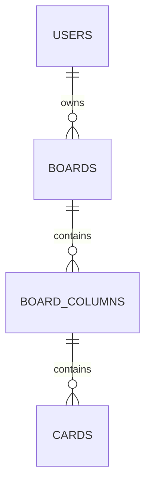

# Канбан-доска · ВятГУ

Учебный JSON API на PHP 8.5, Eloquent и PostgreSQL. Реализованы регистрация, вход, выход, доски с колонками и карточками. Запросы проходят через собственную маршрутизацию и MVC, сессии хранятся в PostgreSQL.

## Задания по порядку

| Задание | Где проверить |
| --- | --- |
| Поднять учебный Local Zoo | [Стенд Local Zoo](https://github.com/ewoeuieu/local_zoo_for_vyatgu) сохраняет исходное окружение nginx, PHP-FPM и PostgreSQL. В его README есть запуск и проверка `/health.php` |
| Скелет, Eloquent, мигратор, Monolog | [История коммитов](https://github.com/ewoeuieu/kanban-vyatgu/commits/main/), [тестовая миграция](migrations/001_create_migration_probe.php), `GET /` и `docker compose logs php` |
| Статический конфиг, шифрование и четыре основные таблицы | [Конфиг и шифрование](#конфиг-и-шифрование), [схема БД](#миграции-и-схема-бд) |
| Метрики, дашборд и проверка сбоя | [Мониторинг канбана](#мониторинг-канбана) |
| Сессии, cron, маршрутизация и базовый контроллер | [Сессии, cron и HTTP-логи](#сессии-cron-и-http-логи) |
| MVC, регистрация, вход, выход, операции досок и карточек | [Маршруты и примеры запросов](#api) |

## Запуск

Нужен Docker с Compose. Первый запуск создаёт локальный `.env` со случайным паролем PostgreSQL и ключом шифрования.

```sh
# Linux / macOS / WSL
docker run --rm --user "$(id -u):$(id -g)" --mount "type=bind,source=$PWD,target=/app" -w /app php:8.5-cli php bin/console init
docker compose up -d --build --wait
```

```powershell
# Windows PowerShell с Docker Desktop
docker run --rm --mount "type=bind,source=$PWD,target=/app" -w /app php:8.5-cli php bin/console init
docker compose up -d --build --wait
```

Если PHP уже установлен, для первого шага достаточно `php bin/console init`. Существующий `.env` можно сразу использовать при повторном запуске.

Откройте [127.0.0.1:8082](http://127.0.0.1:8082/). Поле `migration` содержит тестовую запись, прочитанную через Eloquent. На `GET /health` API проверяет наличие этой записи. Команда `docker compose down` останавливает сервисы и сохраняет базу.

## Миграции и схема БД

При старте PHP-контейнера мигратор под блокировкой применяет новые миграции через Illuminate Schema Builder. Журнал версий хранится в таблице `migrations`. Первый файл создаёт `migration_probes` с тестовой записью.

```sh
docker compose exec php php bin/console status
docker compose exec php php bin/console migrate
# Откат последней партии миграций удаляет созданные в ней таблицы и данные.
docker compose exec php php bin/console rollback
```



`users` хранит email и хэш пароля, `boards` — имя доски и владельца. `board_columns` задаёт порядок колонок, `cards` — порядок карточек и дату архивации. Внешние ключи удаляют дочерние сущности при удалении родителя. `sessions` — служебная таблица с идентификатором, данными PHP-сессии и временем истечения.

## Конфиг и шифрование

В `config/app.php` лежит статический массив. `APP_ENV` выбирает блок `local`, `testing` или `production`, который дополняет `defaults`. Ключ `APP_KEY` — 32 случайных байта в Base64. `php bin/console key:generate` создаёт новый ключ.

```sh
printf '%s' 'Пример значения' | docker compose exec -T php php bin/console config:encrypt
printf '%s' 'enc:v1:…' | docker compose exec -T php php bin/console config:decrypt
```

Строку `enc:v1:…` можно вставить в любой строковый параметр массива, например `message` для демонстрации. При загрузке конфиг вызывает `SecretCipher`, который проверяет тег и расшифровывает значение через OpenSSL AES-256-GCM. Пароль БД и ключ находятся в локальном `.env`, исключённом из Git. При смене ключа нужно повторно зашифровать значения.

## API

Операции `POST` и `PATCH` принимают JSON-объект с заголовком `Content-Type: application/json`. Регистрация и вход возвращают cookie `KANBANSESSID`; сохраните её для следующих запросов.

```sh
curl -i -c cookies.txt -H 'Content-Type: application/json' \
  -d '{"email":"student@example.com","name":"Студент","password":"example-pass-42"}' \
  http://127.0.0.1:8082/register
curl -b cookies.txt http://127.0.0.1:8082/me
curl -b cookies.txt -H 'Content-Type: application/json' \
  -d '{"title":"Учебная доска"}' http://127.0.0.1:8082/boards
curl -i -b cookies.txt -c cookies.txt -H 'Content-Type: application/json' \
  -d '{}' http://127.0.0.1:8082/logout
```

| Метод и путь | Данные и результат |
| --- | --- |
| `POST /register` | `email`, `name`, `password`. Создать пользователя и сессию |
| `POST /login` | `email`, `password`. Начать сессию |
| `POST /logout`, `GET /me` | Завершить сессию или получить текущего пользователя |
| `GET /boards`, `POST /boards` | Список досок или создание с `title` |
| `PATCH /boards/{id}`, `DELETE /boards/{id}` | Изменить `title` или удалить доску |
| `GET /boards/{id}/columns`, `POST /boards/{id}/columns` | Список колонок или создание с `title` |
| `PATCH /columns/{id}`, `DELETE /columns/{id}` | Изменить `title` или удалить колонку |
| `GET /boards/{id}/cards` | Карточки доски, включая архивные с заполненным `archived_at` |
| `POST /columns/{id}/cards`, `PATCH /cards/{id}` | Создать или изменить карточку. Поля `title` и необязательное `description` |
| `POST /cards/{id}/move` | `axis` (`x` или `y`), `direction` (`-1` или `1`). Переместить в соседнюю колонку или поменять местами с соседней карточкой |
| `POST /cards/{id}/archive`, `DELETE /cards/{id}` | Архивировать карточку или удалить её |

Для ошибок ввода API возвращает `422` с полем `fields`. Защищённые действия без сессии возвращают `401`, чужая доска или карточка — `404`.

## Сессии, cron и HTTP-логи

- `DatabaseSessionHandler` реализует PHP-интерфейсы сессий. Он блокирует запись с одним идентификатором на время запроса. При входе идентификатор меняется, при выходе строка и cookie удаляются. В `production` cookie передаётся только по HTTPS.
- Сервис `cron` раз в минуту запускает `php bin/console sessions:prune`. Статистику удаления видно через `docker compose logs cron`. Ту же команду можно запустить вручную через `docker compose exec php php bin/console sessions:prune`.
- В `docker compose logs php` видны JSON-записи Monolog с методом, путём, кодом, временем обработки и телом ответа. Пароль, хэш, входящий JSON и cookie в HTTP-лог не попадают. `LOG_PATH` позволяет указать файл вместо стандартного потока ошибок.
- `Router` передаёт маршрут в `AbstractRequest`. Тот проверяет параметры через `Parameter`, вызывает проверку бизнес-условий и выполняет действие. `FrontendController` отвечает за пользовательские сессии, `BoardController` — за доски, колонки и карточки. `Response` задаёт JSON-ответы и отвечает за отправку HTTP-статуса и заголовков.

## Мониторинг канбана

В исходном Local Zoo Prometheus собирает метрики nginx, PHP-FPM, PostgreSQL и PHP-приложения. В Grafana можно смотреть доступность, длительность и ошибки HTTP-запросов, состояние пула PHP и подключения к БД. Алерты отслеживают сбои компонентов, всплески ошибок и рост задержек. [Исходный стенд](https://github.com/romicharroyo/local_zoo_for_vyatgu)

В канбане `/health` подтверждает, что API читает тестовую запись из PostgreSQL. Даже при выключенном cron вызов продолжает отвечать `200`, а просроченные сессии остаются в таблице. Поэтому задача очистки записывает время последнего успешного запуска и число удалённых сессий в `scheduled_jobs` в одной транзакции с удалением.

| Метрика Prometheus | Что показывает |
| --- | --- |
| `probe_success{job="kanban-health"}` | Доступность `/health`, измеренная Blackbox Exporter |
| `kanban_session_cleanup_age_seconds` | Сколько секунд прошло с успешного запуска или с инициализации задачи |
| `kanban_session_cleanup_last_success_timestamp_seconds` | Время последнего успешного запуска в Unix-секундах. До первого запуска значение равно 0 |
| `kanban_expired_sessions` | Сколько просроченных записей сейчас в таблице сессий |
| `kanban_session_cleanup_deleted_total` | Накопленное число сессий, удалённых задачей |

### Запуск и проверка

Создайте `.env` по инструкции [«Запуск»](#запуск) и выполните команду из корня репозитория.

```sh
docker compose -f compose.yaml -f compose.monitoring.yaml up -d --build --wait
```

Откройте [Grafana «Канбан · очистка сессий»](http://127.0.0.1:3001/d/kanban-sessions) и [таргеты Prometheus](http://127.0.0.1:9091/targets). Оба таргета должны стать `UP`. Приложение отдаёт служебные метрики внутри Docker-сети.

1. Дождитесь, пока cron выполнится. Возраст последней очистки на панели будет сбрасываться примерно раз в минуту.
2. Остановите cron и добавьте одну просроченную сессию в учебную БД.

   ```sh
   docker compose stop cron
   docker compose exec postgres psql -U kanban -d kanban -c "INSERT INTO sessions (id, payload, expires_at) VALUES ('demo-expired-session', '', 0) ON CONFLICT DO NOTHING"
   curl -fsS http://127.0.0.1:8082/health
   ```

3. Панель просроченных сессий покажет запись, а доступность API останется зелёной. Через примерно три минуты после последней очистки алерт `KanbanSessionCleanupStalled` перейдёт в `firing` на [странице Prometheus](http://127.0.0.1:9091/alerts).
4. Выполните `docker compose start cron`. После следующего запуска задачи число просроченных сессий и возраст очистки уменьшатся, а алерт погаснет.

Чтобы остановить учебное окружение с мониторингом, выполните `docker compose -f compose.yaml -f compose.monitoring.yaml down`.
